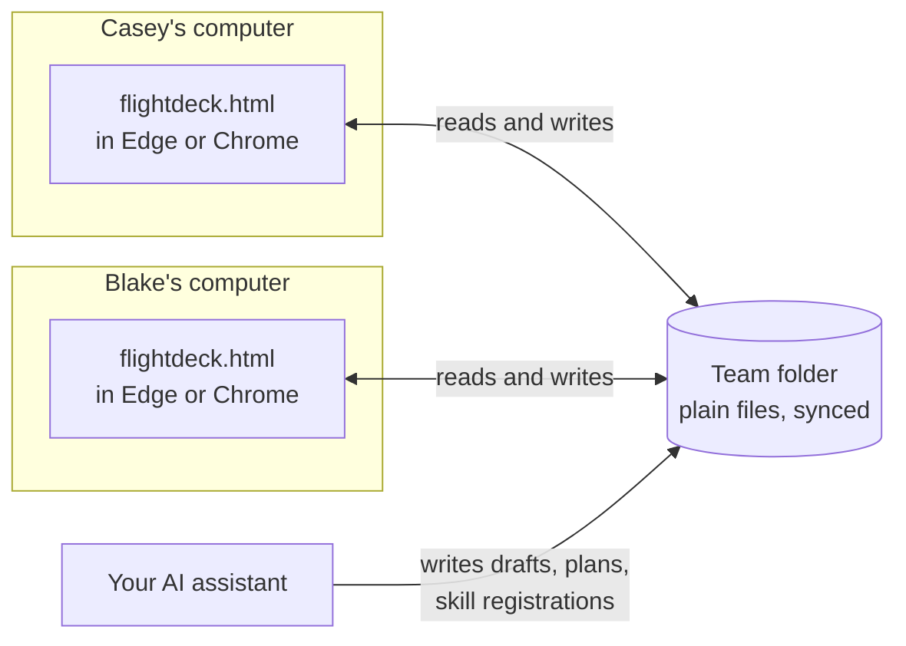
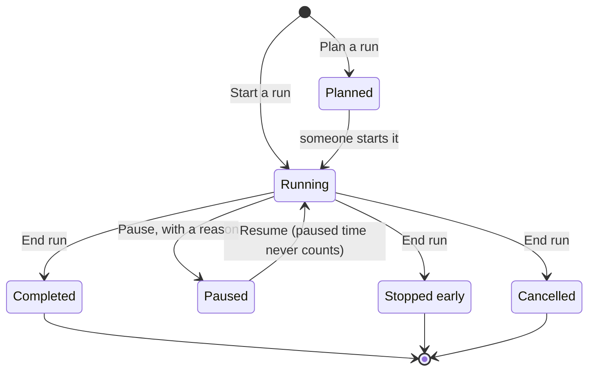
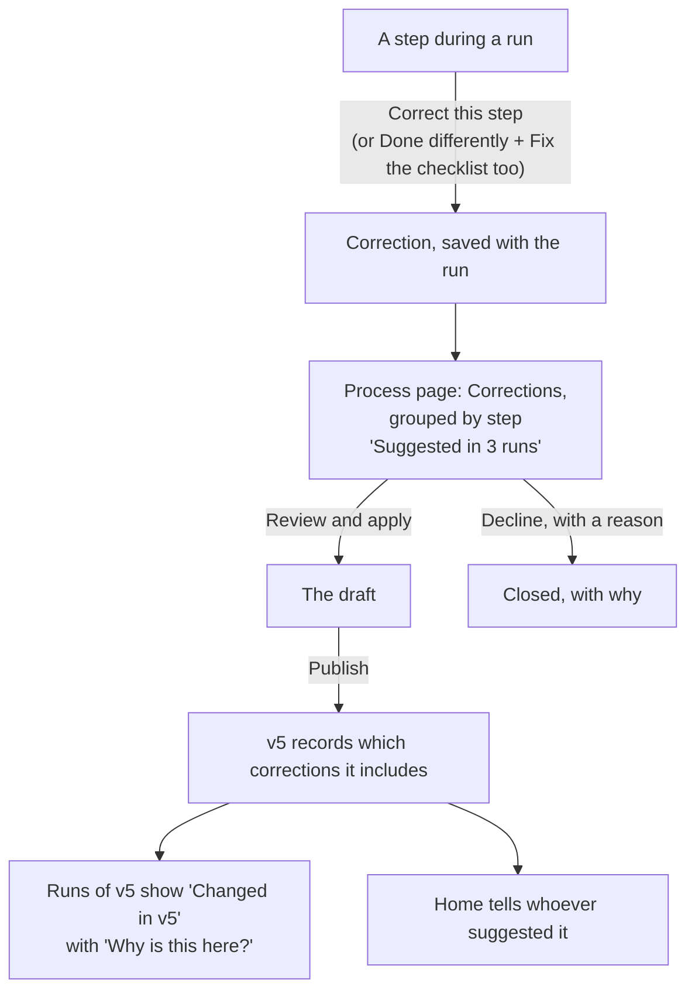
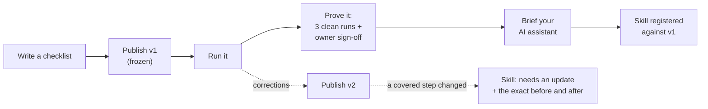
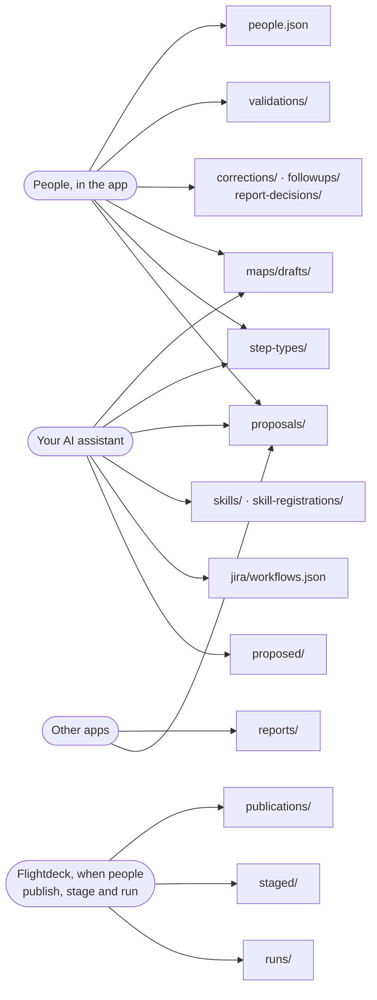

<div align="center">

<picture><source media="(prefers-color-scheme: dark)" srcset="https://raw.githubusercontent.com/troylar/flightdeck/main/docs/images/banner-dark.png"></picture>

<br>

[](https://www.npmjs.com/package/@troylar/flightdeck)
[](#license)
[](#safe-by-design)
[](#safe-by-design)
[](#install)

**[In 60 seconds](#flightdeck-in-60-seconds)** · **[How it works](#how-it-works)** · **[Install](#install)** · **[Tour](#a-tour)** · **[Checklist format](#the-checklist-format)** · **[Process to skill](#process-to-skill-traceability)** · **[FAQ](#faq)**

</div>

<br>

**Flightdeck turns the processes your team keeps in its head into checklists you can run, prove and hand to your AI assistant.**

- **What it is:** one HTML file. No server, no sign-in, no network, no AI inside. It runs offline in Edge or Chrome.
- **Who it's for:** teams with work they repeat: the release, the incident, the access review, the month-end close, the check-in.
- **Why it's different:** your shared folder is the whole backend. Every checklist version is frozen, every run is a record, and every AI skill you build is tied to the exact steps it automates. Change a step, and Flightdeck tells you which skills are now out of date.

<p align="center"><a href="https://github.com/troylar/flightdeck/blob/main/docs/images/run-light.png" title="Open in GitHub's image viewer"><picture><source media="(prefers-color-scheme: dark)" srcset="https://raw.githubusercontent.com/troylar/flightdeck/main/docs/images/run-dark.png"></picture></a></p>

<details>
<summary><b>Contents</b></summary>

- [Flightdeck in 60 seconds](#flightdeck-in-60-seconds)
- [How it works](#how-it-works)
- [Install](#install)
- [A tour](#a-tour)
- [What it does](#what-it-does)
- [The checklist format](#the-checklist-format)
- [Manage your templates in the app](#manage-your-templates-in-the-app)
- [Your own step types](#your-own-step-types)
- [Process-to-skill traceability](#process-to-skill-traceability)
- [Command line](#command-line)
- [The team folder](#the-team-folder)
- [Skills for your AI assistant](#skills-for-your-ai-assistant)
- [Safe by design](#safe-by-design)
- [Coming from Preflight](#coming-from-preflight)
- [FAQ](#faq)
- [More docs](#more-docs)

</details>

<br>

## Flightdeck in 60 seconds

**1. Write a checklist.** It's a Markdown file in your team folder. This one is complete:

```markdown
---
process: docs
title: Publish the docs
owner: person-casey
context: commit
---

## Build · DO-CONFIRM {#build}
- [!] {run.command} Docs build with no warnings ^commit {#build-docs}
  command: npm run docs
- [ ] {confirm} Screenshots match the current app {#shots}

## Gate: Ready to publish {#ready}
  approves: publishing `^commit`

## Publish · READ-DO {#publish}
- [!] {run.command} Push the site ^commit {#push}
  command: npm run docs:publish
```

Two phases, three steps, one gate (plus the final confirmation every checklist gets). `[!]` is a must-do. `{run.command}` is the step's type, so the run shows the command with a Copy button. `^commit` ties a step to a run detail. The gate approves exactly one thing: publishing that commit.

**2. Publish it.** Flightdeck freezes it as **v1**. Runs always keep the version they started on.

**3. Run it.** Choose **Start a run** and type the commit. The Publish phase stays locked until someone passes the gate. Then step through: **Done**, **Done differently**, **Blocked** or **N/A**.

**4. Look in the folder.** Everything is a plain file:

```
docs/                                  ← your team folder (OneDrive, or any folder people share)
├── maps/drafts/docs.md                ← the checklist you wrote
├── publications/docs/v1-k3m9p2q8/     ← v1, frozen: written once, never changed
│   ├── map.md                         ←   the checklist exactly as published
│   ├── types.json                     ←   every step type it uses, copied in
│   └── publication.json               ←   who published it, when, and why
└── runs/docs/9d96paue/                ← one run
    ├── run.json                       ←   answers, gates, details: written only by the recorder's window
    ├── notes-<window>.jsonl           ←   each window's notes and corrections, in its own file
    └── files/                         ←   attachments
```

Here is the gate inside `run.json`, next to what the screen shows:

<table>
<tr><th>In <code>run.json</code></th><th>On screen</th></tr>
<tr><td>

```json
"gates": {
  "ready": {
    "s": "passed",
    "by": "person-casey",
    "at": "2026-10-22T13:17:05.884Z",
    "approved": { "commit": "d9d8514" }
  }
}
```

</td><td>

**Gate: Ready to publish** · PASSED<br>
Approves publishing `d9d8514`<br>
Passed by Casey Nguyen at 9:17 AM for commit d9d8514

</td></tr>
</table>

The gate remembers the commit it approved. Change the commit mid-run, and the gate and every step tied to `^commit` come back for a re-check.

<br>

## How it works

Six ideas carry the whole design.

### 1. The team folder is the whole backend

There's no server. Each person opens the same `flightdeck.html` from a folder the team shares (OneDrive is the tested setup). The app reads and writes plain files there, and the sync tool carries them between computers.



The trick that makes a synced folder safe: **every file has exactly one writer.** The recorder's window writes `run.json`. Every other window writes its own `notes-<window>.jsonl`. Publishing writes a new folder every time. Decisions are new files, written once. Two people never save over each other in ordinary use, so the sync tool never has to merge anything.

### 2. One HTML file

The app, its fonts and its built-in examples are all inside `flightdeck.html`. It makes no network requests. Copy it anywhere and open it. `flightdeck install` puts it in the team folder so everyone opens the same version.

### 3. A checklist is twenty readable lines

A checklist is Markdown that a person can read and an AI assistant can write. Phases end at gates. Steps have types, so each one asks for the right evidence: a build number, a PR link, a decision. Publishing freezes it as a numbered version, with who, when and why. To rehearse a change first, **stage** it: test runs try the staged version while every real run stays on the current default, and **Make v3 the default** publishes exactly what was rehearsed. See [The checklist format](#the-checklist-format) and [Staging and test runs](#staging-and-test-runs).

### 4. A run is a recording

One person **records** a run; everyone else follows along on their own screen and adds notes and files. Every answer keeps who and when. A re-check keeps the earlier answer as history instead of erasing it.



Recording can move between people. **Hand off** saves the run and names the exact revision passed on. **Pick up** continues it in another window. **Take over** is for emergencies, when the recorder's computer is gone.

### 5. Corrections flow back into the checklist

When the checklist is wrong mid-run, anyone can **Correct this step**. The correction rides along with the run as evidence, then waits on the process page until someone acts on it.



### 6. Skills are tied to the exact steps they automate

A skill is reusable instructions for your AI assistant. Flightdeck doesn't run skills; it keeps the link between each skill and the process version it was built from. The link is a small file:

<table>
<tr><th><code>skills/release-deploy.json</code></th><th>What the app shows after v2 changes the deploy step</th></tr>
<tr><td>

```json
{
  "name": "release-deploy",
  "version": "0.4.0",
  "location": "~/skills/release-deploy",
  "implements": "release@1",
  "steps": ["merge", "jenkins"]
}
```

</td><td>

**NEEDS AN UPDATE**<br>
Built from v1. In v2, 1 of its steps changed. Give your AI assistant the update brief: it has the exact before and after.

- **Start the production deploy job**: changed

**Copy the update brief**

</td></tr>
</table>



<details>
<summary><b>Six design choices worth knowing</b></summary>

- **A failed run read is never "nothing there."** If OneDrive hasn't finished syncing a run, or it can't be read, Flightdeck says so by name. It never treats the run as empty. A run whose latest read failed stays on screen, but it doesn't count toward a sign-off until it reads again. A sign-off that can't be read is named; if this window read it before, what it said still counts, and otherwise Flightdeck says it can't tell yet and doesn't offer Sign off. A plan, or a decision on it, that can't be read is named and holds the plan: it can't be started, declined or switched until the decision reads again (every plan, while `proposals/` itself can't be read).
- **Every save leaves a receipt first.** Before writing `run.json`, a window writes its version to its own `candidate-<window>-<save>.json`, and `run.json` lists the saves it includes. If two computers that can't see each other both save, the replaced save isn't on the list, so it shows up in the run as a copy to compare. It's never silently lost.
- **A run save checks the file it's about to replace.** Before every `run.json` save, Flightdeck compares a SHA-256 of the file's exact text with the one it read. If it changed, it writes its version beside the file as a conflict copy instead. Nothing is ever merged automatically.
- **An older copy can't damage what a newer copy wrote.** A run with fields an older Flightdeck doesn't understand opens read-only there, and a version that needs a newer Flightdeck says "Update Flightdeck to run it." Dropping unknown fields on save would erase someone's work, so the older copy never saves.
- **A gate is a record, not a live lock.** A synced folder can be a minute behind, so a gate means "passed for this commit, by Casey, at 9:52," never "safe right now." Irreversible actions always keep a person's confirmation.
- **The run carries its own checklist.** `run.json` holds a snapshot of the exact checklist and step types it started on, so a run reads the same years later, whatever happened to the process since.

</details>

<br>

## Install

```bash
npm install -g @troylar/flightdeck

flightdeck open                        # opens the app: start your team, join one, or look around the examples
```

The first screen offers three ways in:

| Choice | Who | What happens |
|---|---|---|
| **Start your team** | The first person | Pick an empty shared folder (Flightdeck checks it can save there), add your people and a backup owner, publish a first checklist (Code check-in, Weekly review, blank, or one your AI assistant writes), do a first run on your own, then send a teammate the way in and check that their computer answers. The folder owner and backup owner see **Getting started · N of 5** on Home until all five are done; each step ticks itself from what's in the folder. |
| **Join your team's folder** | Everyone else | Open the folder and choose who you are. Not on the list? Copy a request to the folder owner. Only the folder owner and backup owner change `people.json`. |
| **Look around the examples** | Anyone curious | A made-up team, saved in this browser only. |

**Starting a team?** Pick a new, empty folder, so nothing already there is replaced. When setup is done, put Flightdeck in that folder so everyone opens the same version:

```bash
flightdeck install ~/OneDrive/Team     # adds flightdeck.html; keeps the AGENTS.md and skills setup wrote
```

Setup writes `people.json`, `AGENTS.md` and the skills itself; `flightdeck install` afterwards only adds what's missing or still a default. Run it before setup and the folder isn't empty any more, so setup asks for another one.

**Joining a team?** Open `flightdeck.html` from your team's folder in Edge or Chrome.

**Updating later?** Run `flightdeck install` again. It updates what's still a Flightdeck default and keeps what your team changed. [Updating Flightdeck](https://github.com/troylar/flightdeck/blob/main/docs/updating.md) walks through it, including backups and mixed versions. [When something goes wrong](https://github.com/troylar/flightdeck/blob/main/docs/recovery.md) covers conflict copies, lost folder access and restoring.

> **Prefer no npm?** `flightdeck.html` is self-contained. Copy it anywhere and open it.

<br>

## A tour

Choose **Look around the examples**, then **Casey Nguyen** in the top right, and follow along. The top bar has four sections: **Home, Runs, Processes, Settings**. **Skills** and **Step types** open from the Processes page, from Settings and from search.

<table>
<tr>
<td width="50%" valign="top">

**Home** shows only what's yours, each with one button: the run you're recording, a plan to review, a skill to update, and your open follow-ups.

<a href="https://github.com/troylar/flightdeck/blob/main/docs/images/home-light.png" title="Open in GitHub's image viewer"><picture><source media="(prefers-color-scheme: dark)" srcset="https://raw.githubusercontent.com/troylar/flightdeck/main/docs/images/home-dark.png"></picture></a>

</td>
<td width="50%" valign="top">

**Processes** are your templates, in your team's own hierarchy, with **Filter by tag** and each one's version and last run. **New process** starts one.

<a href="https://github.com/troylar/flightdeck/blob/main/docs/images/processes-light.png" title="Open in GitHub's image viewer"><picture><source media="(prefers-color-scheme: dark)" srcset="https://raw.githubusercontent.com/troylar/flightdeck/main/docs/images/processes-dark.png"></picture></a>

</td>
</tr>
<tr>
<td valign="top">

**A process** is one page: its checklist with skill badges, **Start a run**, **Plan a run** and **How runs go**. Its owner and backup owner also see the Corrections people recorded during runs, whether it's ready for a skill, and its skills; everyone else sees each of those as one line.

<a href="https://github.com/troylar/flightdeck/blob/main/docs/images/process-light.png" title="Open in GitHub's image viewer"><picture><source media="(prefers-color-scheme: dark)" srcset="https://raw.githubusercontent.com/troylar/flightdeck/main/docs/images/process-dark.png"></picture></a>

</td>
<td valign="top">

**Edit** in place, as an outline or as Markdown, beside a live check and preview. Your AI assistant's changes show up as you edit, marked and one Undo away.

<a href="https://github.com/troylar/flightdeck/blob/main/docs/images/edit-light.png" title="Open in GitHub's image viewer"><picture><source media="(prefers-color-scheme: dark)" srcset="https://raw.githubusercontent.com/troylar/flightdeck/main/docs/images/edit-dark.png"></picture></a>

</td>
</tr>
<tr>
<td valign="top">

**Skills**: every skill built from your processes, wherever it lives, and which ones need an update.

<a href="https://github.com/troylar/flightdeck/blob/main/docs/images/skills-light.png" title="Open in GitHub's image viewer"><picture><source media="(prefers-color-scheme: dark)" srcset="https://raw.githubusercontent.com/troylar/flightdeck/main/docs/images/skills-dark.png"></picture></a>

</td>
<td valign="top">

**A skill** says what changed under it and gives your AI assistant the exact before and after.

<a href="https://github.com/troylar/flightdeck/blob/main/docs/images/skill-light.png" title="Open in GitHub's image viewer"><picture><source media="(prefers-color-scheme: dark)" srcset="https://raw.githubusercontent.com/troylar/flightdeck/main/docs/images/skill-dark.png"></picture></a>

</td>
</tr>
<tr>
<td valign="top">

**Flight plan** shows a version's shape: phases from start to landing, gates as checkpoints, tracks side by side, and, from that version's runs, typical times, autopilot (steps skills cover) and turbulence.

<a href="https://github.com/troylar/flightdeck/blob/main/docs/images/flight-light.png" title="Open in GitHub's image viewer"><picture><source media="(prefers-color-scheme: dark)" srcset="https://raw.githubusercontent.com/troylar/flightdeck/main/docs/images/flight-dark.png"></picture></a>

</td>
<td valign="top">

The **Builder** edits a draft as an outline: drag a step or press Alt+Up / Alt+Down, change it in the side form (text, type, roles, fields, notes, and screenshots by paste or drop), and **Undo**. It writes the same Markdown.

<a href="https://github.com/troylar/flightdeck/blob/main/docs/images/builder-light.png" title="Open in GitHub's image viewer"><picture><source media="(prefers-color-scheme: dark)" srcset="https://raw.githubusercontent.com/troylar/flightdeck/main/docs/images/builder-dark.png"></picture></a>

</td>
</tr>
<tr>
<td valign="top">

**Runs**: what's running, what's **planned** (by a person or your AI assistant) and what finished.

<a href="https://github.com/troylar/flightdeck/blob/main/docs/images/runs-light.png" title="Open in GitHub's image viewer"><picture><source media="(prefers-color-scheme: dark)" srcset="https://raw.githubusercontent.com/troylar/flightdeck/main/docs/images/runs-dark.png"></picture></a>

</td>
<td valign="top">

**Plan a run** for later: the details you know, who does what, and an optional time. Nothing starts until someone starts it.

<a href="https://github.com/troylar/flightdeck/blob/main/docs/images/plan-light.png" title="Open in GitHub's image viewer"><picture><source media="(prefers-color-scheme: dark)" srcset="https://raw.githubusercontent.com/troylar/flightdeck/main/docs/images/plan-dark.png"></picture></a>

</td>
</tr>
<tr>
<td valign="top">

**Correct this step** during a run: it starts on the wording, with a live Before/After redline. **Change something else** covers a missing step, the order, who does it, a screenshot, removing the step, or any other problem. The checklist's own text stays on screen.

<a href="https://github.com/troylar/flightdeck/blob/main/docs/images/correction-light.png" title="Open in GitHub's image viewer"><picture><source media="(prefers-color-scheme: dark)" srcset="https://raw.githubusercontent.com/troylar/flightdeck/main/docs/images/correction-dark.png"></picture></a>

</td>
<td valign="top">

**Corrections** on the process page, grouped by step: the same correction from several runs shows once, "Suggested in 2 runs". **Review and apply** puts it in the draft as one change you can undo.

<a href="https://github.com/troylar/flightdeck/blob/main/docs/images/corrections-light.png" title="Open in GitHub's image viewer"><picture><source media="(prefers-color-scheme: dark)" srcset="https://raw.githubusercontent.com/troylar/flightdeck/main/docs/images/corrections-dark.png"></picture></a>

</td>
</tr>
</table>

<details>
<summary><b>More on corrections</b></summary>

- **Review and apply** compares what the run's version said, the draft now and the result side by side, then applies it to the draft in one click. If the draft already has it, **Link this correction**.
- You can also **Mark as applied**, **Decline** with a reason, or reopen one, and copy a correction brief for your AI assistant.
- The draft editor marks the steps with open corrections.
- Publishing records which applied corrections the version includes. A correction then says **Published in v5** once v5 both lists it and says it.
- Runs of v5 show **Changed in v5** on that step, with **Why is this here?**, and Home tells whoever suggested it.

</details>

### The run screen

A run fills the window, like the editor.

| Part | What it shows |
|---|---|
| **Header** | How far it is (`7/15 answered`), **Details**, **Screen share**, **Receipt** and **More** (with **Copy run key**). A test run says **Test run** beside its name. |
| **Recording strip** | Who's recording, with **Pause** and **Hand off** (or **Pick up**, **Record here**, **Take over**), the run's details, and what this window saved and when it last checked the folder. |
| **Phases** | Each phase and its gate's state, plus the day timeline and follow-ups. A phase shows its note and screenshots under its heading. |
| **Checklist** | Every step, with **Next up** pinned at the top. A gate shows its note above **Pass the gate**. A phase still behind its gate offers **Preview steps**, and a finished one folds to a tally with **Show steps**. Steps this run doesn't need fold into one line at the end of their phase, **1 step not needed**, each with its reason; a phase it doesn't need is one **Not needed** line, gate included. The receipt lists them under **Not needed in this run**. |
| **Selected step** | How to do it, the values to copy, the evidence to record, then **Done**, **Done differently**, **Blocked** and **N/A**, and the step's corrections and notes. |

<details>
<summary><b>Keyboard, drafts, files and tools</b></summary>

- **Keyboard.** Check the step Next up points at, and the next one is selected, ready for **Space**. The row's check, **Done**, **Space** and **Done differently** all answer that one step with the evidence typed on it.
- **Nothing typed is lost.** Typed evidence, Fill in values and unsent notes stay with their step (and their team folder) when you move around, and the row says **Draft**. While a step's Fill in is open or unsaved, Done says "Save or cancel Fill in first."
- **Done differently** asks what happened, and can fix the checklist too.
- **Files.** Notes and corrections take files: drop them on the note box, paste, or **Attach**. Images, PDF, text and logs, CSV, JSON, YAML and .zip, up to 10 MB each.
- **Reports from tools.** When a tool reported a step's work (`flightdeck report write`), the step shows the report and whether its inputs match the run. The recorder accepts or declines it.
- **On a phone** the checklist scrolls and a step opens as a full-screen sheet.

</details>

<br>

## What it does

<p align="center"><a href="https://github.com/troylar/flightdeck/blob/main/docs/images/features-light.png" title="Open in GitHub's image viewer"><picture><source media="(prefers-color-scheme: dark)" srcset="https://raw.githubusercontent.com/troylar/flightdeck/main/docs/images/features-dark.png"></picture></a></p>

<details>
<summary><b>Every feature, in detail</b></summary>

<table>
<tr>
<td width="50%" valign="top">

### Checklists with teeth
Every phase ends at a **gate**. Nothing after it opens until someone passes it, and a gate approves exactly what it says: `deploy of d9d8514 to production`. Must-do steps can't be skipped. Change the commit mid-run and every step tied to it comes back for a re-check.

</td>
<td width="50%" valign="top">

### One recorder, everyone watching
One person records; everyone else follows on their own screen and adds notes, screenshots and files (logs, PDFs, .zip) to any step. Hand recording over, or pick it up from another window. Every save first checks the file hasn't changed; if it has, yours is kept next to it as a copy you can compare and keep.

</td>
</tr>
<tr>
<td valign="top">

### Steps that know their tools
Steps are typed: `jenkins.job`, `bitbucket.pr`, `github.pr`, `jira.issue`, `jira.sprint`, `deploy`, `verify.health`, `measure`, `run.command`, `decide`, `review` and more, plus your team's own types. Each asks for the evidence that matters (a build number, a PR link, a decision) only where the checklist says it's required. Evidence can be typed (a number, yes or no, a date, a choice, a link) and is checked as you type it.

</td>
<td valign="top">

### Jira, the way it really is
Point Flightdeck at your real Jira workflow and a transition can't publish if Jira can't make it. Checking it asks for the transition's required fields, with a hint for each, and fills in the ones it can from the run.

</td>
</tr>
<tr>
<td valign="top">

### Time, tracks and pauses
Give a step a clock time, a deadline, or "within 2 hours of starting" and it gets a badge, a place on the day timeline, and a reminder. Split a phase into parallel tracks. Pause a run with a reason; paused time never counts.

</td>
<td valign="top">

### Processes inside processes
A step can start another process as a linked child run, passing on the details it needs, and can name the exact version to run. The parent step is checked only when that child completes, with the same values it was started for.

</td>
</tr>
<tr>
<td valign="top">

### Values that flow
A step can **set** a run detail: the merge step records the release tag, and every later `^tag` in commands, messages and Jira fields uses it. Correct it later and the steps that used the old value come back for a re-check. Run details can be typed too, so a number or a date is checked when it's entered. With `only when`, a later step or phase applies only when a value matches, so one checklist covers both paths.

</td>
<td valign="top">

### Runs that teach the checklist
Every block, every re-check and every step **done differently** is kept. Anyone in a run can **correct a step**, with files to show why. Corrections wait on the process page until someone applies or declines them. A process's **How runs go** shows typical time per phase, the steps that go off-script most, and who has never held which role yet, so the next rotation is obvious.

</td>
</tr>
<tr>
<td valign="top">

### Other apps work beside a run
Scripts and tools read checklists and runs as JSON, ask for a run, or report the work they did on a step. A person always decides: a request becomes a planned run someone starts, and a report is accepted or declined by the recorder. See [Command line](#command-line).

</td>
<td valign="top">

### Evidence you can hand to an auditor
Export one run, or every run of a process over a date range, as a zip of the original files with a readable page and SHA-256 hashes to check them by. Making a pack never changes the team folder. See [Evidence packs](https://github.com/troylar/flightdeck/blob/main/docs/evidence.md).

</td>
</tr>
</table>

</details>

<br>

## The checklist format

Checklists are Markdown. Your AI assistant writes them; people edit and publish them, in the builder or as Markdown. Here is a fuller one:

```markdown
---
process: release
title: Production release
group: Engineering / Releases
tags: production, deploy
owner: person-casey
context: ticket, commit, environment, tag, risk:choice(low|high)
roles: release-lead, qa, backend
---

## Before production changes · DO-CONFIRM {#prep}
- [!] {ci.gate} Full test gate green on the release commit ^commit {#tests}
  require: run
- [!] {confirm} Change board approved the release ^ticket {#cab}
  only when ^risk is high

## Gate: Ready to deploy · owner @release-lead {#ready}
  approves: deploy of `^commit` to ^environment

## Deploy · READ-DO {#deploy}
- [!] {bitbucket.pr} Merge the release branch to master ^commit @release-lead {#merge}
  sets: tag
- [!] {jenkins.job} Start the production deploy job ^tag @backend {#jenkins}
  parameters: TICKET=^ticket TAG=^tag
  after: 2h
```

| Mark | Means |
|---|---|
| `[!]` · `[ ]` · `[~]` | Must do · a step · automation planned |
| `{type}` | What kind of step, so it knows its fields and evidence |
| `@role` · `^detail` | Who does it · a run detail it depends on (change the detail, redo the step) |
| `sets: tag` | This step produces a run detail later steps use |
| `only when ^risk is high` | Under a step, or right under a phase heading: it applies only to runs whose details match. Otherwise it's Not needed, with the reason |
| `## Gate:` · `approves:` | The pause point, and exactly what passing it approves |
| `### Track: Name @role` | Parallel work inside a phase |
| `at:` · `due:` · `after:` | A clock time, a deadline, or a due time after the run starts |
| `{run.process}` · `carry:` · `version:` | Start another process as a linked child run, passing these details, on an exact version if you name one |
| `group:` · `tags:` | Where the process sits in your hierarchy, and how to find it |
| `context: rows:number, due:date` | Typed run details (number, yes-no, date, choice, link), checked as they're typed |
| `> note` · `` | A note or screenshot, under a step, a phase or a gate |

Publishing freezes a checklist as a numbered version, with who, when and why. Runs keep the version they started with, forever.

**Steps only some runs need.** In a run whose details don't match, an `only when` step is Not needed: it isn't counted, nobody checks it, and its reason stays one click away. A phase that isn't needed is skipped with its gate. Branching is `sets:` plus `only when`: one step sets a detail, and a later phase applies only when it matches. The process page and the flight plan show each condition as one muted line, *Only when risk is high*. **How runs go** leaves a run out of a step's numbers (corrections included) when that run didn't need the step, and **Ready for a skill?** never holds Not needed itself against a run, though something that already happened on the step still counts (for example, a step done and then sent back for re-check when a detail changed). It names conditional steps no clean run has needed yet.

Typed details, phase notes, phase and gate screenshots, and `version:` need Flightdeck 2.0; `only when` needs Flightdeck 2.1. Before you publish, the publish panel names what the draft uses under **Needs Flightdeck 2.0** or **Needs Flightdeck 2.1**, and teammates on an older copy see that version but can't run it. The full format is in [docs/map-format.md](https://github.com/troylar/flightdeck/blob/main/docs/map-format.md).

<br>

## Manage your templates in the app

A process is one page, with its checklist in the middle.

| To | Do this |
|---|---|
| **Read it** | The **Checklist** view shows it the way a run does; **Markdown** shows the source to copy. |
| **See its shape** | **Flight plan**: phases as waypoints, gates as checkpoints, tracks as parallel lanes, linked processes as connecting flights. From that version's runs and skills it adds typical times, autopilot (steps skills cover) and turbulence (steps that go off-script most). Each phase's steps open under it, or all at once with **Show all steps** and **Hide all steps**. Choose a phase to jump to it. |
| **Edit it** | **Edit** opens the draft on a page of its own, with the **Builder** or the **Markdown** beside a live check (what blocks publishing, and what's just a tip) and a preview. |
| **Look back** | The Versions panel shows the newest, with every version under **All versions**. An older version shows a way back to the current one and **Restore as draft**. |
| **Try it first** | **Practice** in the editor runs the draft as you edit it, recording nothing. Then, under **All versions**, **Stage the draft for testing**, then **Start a test run** on the staged line. Real runs stay on the current default until someone chooses **Make v3 the default**. See [Staging and test runs](#staging-and-test-runs). |
| **See how runs go** | **How runs go**: typical time per phase, the steps that go off-script most, and who has held each role. |
| **Plan ahead** | **Plan a run**, next to **Start a run**: a name, the details you know, who does what and an optional time. |

<details>
<summary><b>The editor in detail</b></summary>

- **Layout.** Parts, the outline, and an inspector with Selected, Checks and Preview tabs, each scrolling on its own.
- **Builder.** Phases are cards, steps are rows, parallel lanes sit side by side, and gates are striped bars. The parts box starts with Phase, Gate, Step and Must-do; every other part is under **All parts**. Add a part by dragging it, or by choosing a part and a place with the arrow keys. Drag a step or press Alt+Up / Alt+Down to move it. **Undo** and **Redo** step through builder changes.
- **The side form** edits a step's text, type, roles, run details, fields, notes and screenshots, or a lane's name and role. The builder also edits the checklist's own details.
- **Only when…** In a step's or a phase's form, once the checklist has run details. Write one condition a line, like `^risk is high`; one that can't be read is refused beside the box. Lines written another way are shown, and left to the Markdown view.
- **Same Markdown.** Both views edit the same file. The builder changes only the lines you touch, never a step ID, and keeps comments and lines it doesn't understand.
- **Saving and publishing.** **Save draft**, then **Done**. **Publish** appears when the draft has saved changes, and stays off while there are unsaved edits.

</details>

<details>
<summary><b>Plans, versions this copy can't use, and careful saving</b></summary>

- **Plans.** **Plan another like this** on any run or receipt copies its details and roles, never its answers. Planned runs are listed by time under **Runs** and show on Home when they're due. A plan starts on the version it was planned on until you switch to the newer one.
- **Versions this copy can't use** are listed with the reason: still syncing, damaged, or written by a newer Flightdeck ("update Flightdeck to run it"). They can't be started, planned or picked, and a run started on one by a newer copy opens read-only, so this copy never saves over it.
- **Careful saving.** A save only goes through if the draft is still exactly what you opened. If a teammate changed it meanwhile, nothing is saved: you see their version and choose to keep yours or take theirs.
- **Your AI assistant, live.** If your AI assistant changes a draft you have open with nothing unsaved, its change appears in the editor within seconds, marked "Changed by your AI assistant." Otherwise it waits on the process page as a proposal to Apply or Decline.
- **One limit.** A shared folder can't lock a file, so a change that lands in the instant between that check and the write can still be replaced. Edit a draft with one person (or one AI assistant) at a time. Saving never publishes; publishing is a separate, logged step.

</details>

**New process** on the Processes page asks for a title; the file name is made from it and shown before you create it. The group, tags, run details, roles, owner and file name are under **More options**. Start blank, from Code check-in or Weekly review (publish v1 as it is, or open it in the editor), or copy a prompt for your AI assistant.

### Practice while you edit

**Practice** in the draft editor runs what's on screen without recording anything: check steps, pass gates, give run details sample values, and keep editing as you go. A step you change shows **Try it again**; a gate whose steps or details changed asks to be passed again. It's kept in this browser tab only, never written to the team folder, and never counted as a run. Links and commands you follow still act on real systems. When you get through the whole checklist, **Stage it for a test run**. See docs/design.md, section 34.

### Staging and test runs

A stage is a safe rehearsal: the next version, tried by test runs, while every real run stays on the current default.

1. **Stage it.** With a changed draft, open **All versions** on the process page, write the change note, and choose **Stage the draft for testing**. It's written once to `staged/` and never edited.
2. **Try it.** **Start a test run** on the staged line opens its own start form. A test run is recorded like any run, but it's labeled **Test run** everywhere it shows (Runs, Home, Recent runs, the run header, the receipt, search and evidence) and it's never counted as a real run: **How runs go** says how many it left out, and Home's running number, last-run dates and role rotation skip it. Its follow-ups and corrections are real.
3. **Prove it.** Once the staged version has test runs, its line says how many are clean ("2 of 3 clean test runs"). With three, its owner (or the backup owner while the owner is away) gets **Sign off staged v3**.
4. **Make it the default.** **Make v3 the default** publishes exactly what was staged as the next version. If someone published meanwhile, it takes the next number and says so. **Ready for a skill?** then counts those clean test runs and that sign-off for v3, and says they're from while it was staged. Nothing from a test run counts for any other version.

**Retire** sets a stage aside and **Reopen** brings it back. Anyone can stage, make a stage the default, retire or reopen, and each is logged with their name. It all lives inside the closed **All versions**, out of the way until someone stages. Plans never start a test run, and a test run starts no linked runs, so a test run that needs a linked-run step never counts as clean (one where that step is Not needed can).

<p align="center"><a href="https://github.com/troylar/flightdeck/blob/main/docs/images/testrun-light.png" title="Open in GitHub's image viewer"><picture><source media="(prefers-color-scheme: dark)" srcset="https://raw.githubusercontent.com/troylar/flightdeck/main/docs/images/testrun-dark.png"></picture></a></p>

<br>

## Your own step types

Built-in types cover common tools (General, Tools and Automation) and stay folded under **Built-in types** until you open them. Your team's types come first, in their own groups, with a tag filter. When your team has its own kind of step (a change request, a security sign-off), make it a type:

1. **Step types → New step type**, or **Copy to a team type** on any built-in.
2. Give it a **group** and **tags** if you like (they only organize the list), then add rows for its **fields** (what a checklist can say about the step) and its **evidence** (what's recorded when it's checked). The form checks it as you go and shows the checklist line and the file it will save.
3. **Save step type** writes `step-types/<id>.json`. Checklists can use `{your.type}` right away. Publishing freezes it into each version, so editing it later never changes an old one.

Or describe it to your AI assistant: `/flightdeck-new-step-type a change request the CAB approves, with the change number as evidence`.

<p align="center"><a href="https://github.com/troylar/flightdeck/blob/main/docs/images/types-light.png" title="Open in GitHub's image viewer"><picture><source media="(prefers-color-scheme: dark)" srcset="https://raw.githubusercontent.com/troylar/flightdeck/main/docs/images/types-dark.png"></picture></a></p>

<br>

## Process-to-skill traceability

This is what Flightdeck is for. Outside the team it's usually called **SOP-to-skill**: turning a standard operating procedure into an agent skill. Flightdeck adds the part that's usually missing: **traceability**. Each registered skill links to the exact process version and steps it follows, and runs are the evidence. Flightdeck flags process changes that affect a skill; it doesn't detect changes to the skill itself.

<p align="center"><a href="https://github.com/troylar/flightdeck/blob/main/docs/images/skills-traced-light.png" title="Open in GitHub's image viewer"><picture><source media="(prefers-color-scheme: dark)" srcset="https://raw.githubusercontent.com/troylar/flightdeck/main/docs/images/skills-traced-dark.png"></picture></a></p>

- **Built from proof.** Prove a version with three clean runs and its owner's sign-off, then brief your AI assistant to build the skill.
- **Traced to the step.** Each registered skill links to an exact process version and the steps it covers (or the whole process), plus where its source lives.
- **Changes flagged.** Publish a new version and Flightdeck shows which registered skills follow steps that changed, and which are still current.
- **Fixes, briefed.** One click copies an update brief: the before and after of each changed step, and the process as it is now.
- **Evidence kept.** Every run keeps who checked each step, what was marked N/A, and where people did it differently.

<p align="center"><a href="https://github.com/troylar/flightdeck/blob/main/docs/images/trace-light.png" title="Open in GitHub's image viewer"><picture><source media="(prefers-color-scheme: dark)" srcset="https://raw.githubusercontent.com/troylar/flightdeck/main/docs/images/trace-dark.png"></picture></a></p>

<details>
<summary><b>How it works, step by step</b></summary>

**1. Prove a version.** Each process page shows its run evidence. A run counts as clean only when:

- it ended Completed;
- every covered step was done;
- every gate on that work (and the one before it) was passed;
- nothing was blocked, re-checked, marked N/A or done differently, even in answers since archived.

A step the run didn't need (`only when`) isn't required, and being Not needed isn't held against the run; a re-check or other deviation recorded on it earlier still is. A test run counts only for its staged version and the version made from exactly what was staged.

**2. Sign off.** With three clean runs, the process owner signs the version off. Only the owner's sign-off counts, and only for that exact published version, or for a staged version with **Sign off staged v3**, which counts for the version made from it.

**3. Brief your AI assistant.** One click copies a brief with the process in order: phases and their mode, tracks, every step with its fields, evidence and screenshots, every gate with what it approves, the run details it receives, and what people actually did differently.

**4. Register the skill.** It can live anywhere: a repo, a shared folder, a local path. Its `location` is the skill's source path or link:

```json
{
  "name": "release-deploy",
  "version": "1.3.0",
  "location": "https://git.example.com/team-skills/release-deploy",
  "implements": "release@4",
  "steps": ["merge", "jenkins"],
  "group": "Engineering / Releases",
  "tags": ["deploy"]
}
```

Leave out `steps` for a skill that covers the whole process. A process can have many skills. For a version made with Flightdeck 2.0, your AI assistant can register the skill with `flightdeck skill register`, which records the exact version it was built from in `skill-registrations/`.

**5. Stay in step.** When a new version is published, every skill is checked against it:

| Status | Meaning | What you do |
|---|---|---|
| **current** | Built from the version in use | Nothing |
| **note version** | The process changed, but none of this skill's steps did | Move its `implements` forward |
| **needs update** | Its steps, their order, their gates, their step types, screenshots or run details changed | Copy the update brief: the exact before and after, for your AI assistant |
| **check it** | It can't be matched: a missing version, a clash, or an unreadable file | Fix the registration |

The same rules are in the `flightdeck-skill-brief` skill for your AI assistant, so a brief your AI assistant writes and a brief from the app agree.

</details>

<br>

## Command line

**For people:**

| Command | Does |
|---|---|
| `flightdeck open` | Opens the app (it starts on the built-in examples) |
| `flightdeck install <folder>` | Copies `flightdeck.html` into a team folder, and adds or updates `AGENTS.md` and the skills for your AI assistant in `.flightdeck/skills`. Won't replace a newer app or an unrecognized file without `--force`. Also updates a `preflight.html` already there |
| `flightdeck skills <folder>` | Adds or updates only the skills, in `<folder>/.flightdeck/skills` |
| `flightdeck skills --to <dir>` | The same, into any other folder you name, such as your assistant's own skills folder or another repo. `<dir>` is created if it's missing |
| `flightdeck backup <folder>` | Copies the whole team folder to `~/Flightdeck backups/<folder> backup <date> <time>/`, or under `--to <dir>`. Skips links and temporary files, and refuses a destination inside the folder |
| `flightdeck export <folder> --run <process>/<id>` | Makes an evidence pack of one run in `~/Flightdeck evidence/` (or `--out <dir>`, never inside the team folder). Prints the pack's SHA-256 to keep somewhere separate. Reads only |
| `flightdeck export <folder> --process <id> --from YYYY-MM-DD --through YYYY-MM-DD` | The same for every run of a process started on those days, both included, in `--tz Area/City` (this computer's time zone unless you say) |
| `flightdeck path` | Prints where the app file is |
| `flightdeck version` | Prints the version |

**For other apps** (they read the folder the way a teammate would, and never act for a person):

| Command | Does |
|---|---|
| `flightdeck processes <folder> --json` | Every process and its versions |
| `flightdeck process <folder> <process> --json` | One version of a checklist (the latest usable one, or `--version N`, or `--folder v3-…`, or a staged one with `--stage stage-…` and `--contract 2`): phases, steps, gates and the evidence each step can record |
| `flightdeck runs <folder> --json --contract 2` | Runs and planned runs, with `--process <id>` and `--status running\|planned\|ended\|all`. Test runs are left out and counted unless you add `--tests --contract 2` |
| `flightdeck run <folder> <process>/<run id> --json` | One run in full: each step's state, who and when, what was recorded, gates and follow-ups. In the app, a run's **More** menu has **Copy run key** |
| `flightdeck next <folder> <process>/<run id> --json` | What's waiting in a run and on whom; `--person <id>` adds that person's own next step |
| `flightdeck followups <folder> --json` | Every follow-up and what became of it, with `--process <id>` and `--status open\|all` |
| `flightdeck plan request <folder> <request.json \| -> --key <key>` | Ask for a run. Writes one planned run to `proposals/`, once, for a person to review and start in the app. The same key and request again writes nothing. `--dry-run` shows what it would write; `--json` prints the result as JSON |
| `flightdeck report targets \| check \| write` | Report work a tool did on a step. `targets` lists running runs' steps and the evidence each records; `check` checks a report; `write` writes it once to `reports/`. A report never checks a step: the run's recorder accepts or declines it in the app |

**For your AI assistant:**

| Command | Does |
|---|---|
| `flightdeck draft read <folder> <process> --json` | The draft's exact text and revision, who has it open, and this session's proposals |
| `flightdeck draft save <folder> <process> --expect <rev\|none> --from <file\|-> [--base <file>] --json` | Writes the draft only when nobody has it open and it's exactly what was read; otherwise writes a proposal a person applies in the app. If the text you started from is gone (someone changed the draft since you read it), it writes nothing and asks for it with `--base` |
| `flightdeck draft propose …` | The same arguments, `--json` included; writes a proposal instead of the draft, with the same `--base` rule |
| `flightdeck skill register <folder> --from <file\|->` | Registers a skill against the exact version it was built from (versions made with Flightdeck 2.0). The only writer of `skill-registrations/` |

**Options:**

| Option | Does |
|---|---|
| `--check` | With `install` or `skills`: lists what would change and changes nothing. Exit code 0: nothing to do; 2: updates to install; 3: files your team changed need merging; 1: a problem |
| `--app-only` | With `install`: copies only `flightdeck.html` |
| `--force` | Replaces a newer app, an unrecognized file, or files your team changed. Like every install, it first saves a checked copy of each file it replaces in `.flightdeck/updates/<version>/replaced/` |
| `--no-attachments` | With `export`: lists attachments with their sizes instead of packing them |

<details>
<summary><b>Exit codes and guarantees</b></summary>

**The JSON commands** only read, never through a link, and never change a file in the team folder. Every result says which contract it follows (`flightdeck-read/1`; `--contract 2` adds typed values, conditions and test runs) and names, file by file, anything it couldn't read. Exit code 0: complete; 4: partial (the data is still printed, with each problem listed); 1: no data; 5: no such process, version or run. People-directory email fields are omitted. See [Using Flightdeck from other apps](https://github.com/troylar/flightdeck/blob/main/docs/apps.md).

**`flightdeck plan request`** lets another app ask for a run, the way a teammate would put one on the calendar. A monthly script asks for the backup check with `--key 2026-11`; asking again with the same key and the same request changes nothing, and the same key with other details is refused. The request shows under **Runs** as a planned run, "requested by" the tool, by its own account: the name is what the file says, not proof of who wrote it. Nothing starts by itself; a person starts it, changes it or declines it. It writes only in `proposals/`, never through a link. Exit 0 when written, 4 when something it depends on couldn't be read and nothing was written, 1 when it's refused, 5 when there's no such process or version.

**`flightdeck report write`** lets a tool say it did a step's work, in a report the step shows beside what a person decided and whether its inputs match the run. Accepting a passing report checks the step with exactly its evidence; the receipt and Evidence name the report and its hash. See *Reporting work* in [docs/apps.md](https://github.com/troylar/flightdeck/blob/main/docs/apps.md).

**`export`** exits with 0 for a complete pack, 4 for a partial one (made, and it lists at the top what changed or was missing while it read), and 1 when it made no pack. It writes `<name>.zip.partial` as it goes and renames it only when it's done; Ctrl+C or a failure removes it. It uses only the code in its own installed `flightdeck.html`, never a team folder's copy, and never reads through a link. The people directory's email fields are left out; original records and attachments may contain personal information. A pack isn't signed: its hashes show whether its files still match, and comparing its SHA-256 with the one you kept shows whether it's the pack you made. See [Evidence packs](https://github.com/troylar/flightdeck/blob/main/docs/evidence.md).

**Install and skills** sort every `AGENTS.md` and skill file the same way:

- A file that's still a Flightdeck default (this version's or an earlier one) is updated.
- A file your team changed is left alone. If this version changed that file's default too, the new default goes to `.flightdeck/updates/<version>/`, with a `README.md` holding a prompt for your AI assistant to merge it.
- In `AGENTS.md` only the part between the `flightdeck:begin` and `flightdeck:end` markers is Flightdeck's. Team notes, below it, are never touched.
- `.flightdeck/installed.json` records which defaults the folder is based on. It can make install more careful, never less.
- Every file install replaces is first copied to `.flightdeck/updates/<version>/replaced/`.
- A file that changes while install runs is left alone, and install exits with 1. Nothing is written through a link or outside the folder (see [Updating Flightdeck](https://github.com/troylar/flightdeck/blob/main/docs/updating.md) for the limits).

</details>

<br>

## The team folder

<p align="center"><a href="https://github.com/troylar/flightdeck/blob/main/docs/images/folder-light.png" title="Open in GitHub's image viewer"><picture><source media="(prefers-color-scheme: dark)" srcset="https://raw.githubusercontent.com/troylar/flightdeck/main/docs/images/folder-dark.png"></picture></a></p>

Every file has exactly one writer, which keeps ordinary use of a shared folder free of conflicts. When two saves do collide, the replaced one is kept for you to recover. Your AI assistant writes checklists, plans, step types, workflows and skill registrations; tools write reports; people publish, plan, run and sign off.



<details>
<summary><b>The folder, as text</b></summary>

```
people.json            who's on the team, with the folder owner and backup owner
maps/drafts/           checklists being written (Markdown)
publications/          published versions, frozen (Flightdeck writes these)
staged/                staged versions only test runs use, and each retire or reopen, written once
runs/                  one folder per run: run.json, everyone's notes and corrections, attached files
skills/                skill registrations: each skill's source, what it implements
skill-registrations/   skills registered with flightdeck skill register (Flightdeck 2.0)
validations/           owners' sign-offs that a version, or a staged version, is ready for a skill
corrections/           decisions on corrections (applied, declined, reopened, withdrawn), each a file written once
followups/             what became of each follow-up (done, moved, won't do, reopened), each a file written once
suggestions/           decisions on suggested fixes from before 1.13 (still read)
step-types/            your team's own step types (create them in the app)
jira/workflows.json    your real Jira workflows, with required fields
proposals/             planned runs (from the app, your AI assistant or another app), waiting for a person to start them
proposed/              draft changes your AI assistant proposed, waiting to be applied or declined
reports/               reports from tools that did a step's work (flightdeck report write)
report-decisions/      the recorder's accept or decline on each report
images/                screenshots that checklists refer to
history/               saved history of drafts and step types
presence/              which drafts a window has open, so your AI assistant knows to propose instead of save
connection/            connection checks between computers (Settings → Folder health)
AGENTS.md              the rules any AI assistant follows in this folder (your own go under Team notes)
.flightdeck/skills/    the Flightdeck skills for your AI assistant
.flightdeck/installed.json   which Flightdeck defaults AGENTS.md and the skills are based on
.flightdeck/updates/   new defaults waiting to be merged, and copies of files install replaced
```

</details>

<br>

## Skills for your AI assistant

`flightdeck install` puts these in the team folder's `.flightdeck/skills/` (`flightdeck skills` does only the skills), or `flightdeck skills --to <dir>` puts them anywhere else. They're plain `SKILL.md` files (a name, a description and instructions), so any assistant that supports skills can use them. Install them where your assistant looks for skills, or point it at the folder. Then open the team folder with your assistant and ask for one by name:

| Skill | Does |
|---|---|
| `/flightdeck-new-checklist` | Turns a runbook, notes or a conversation into a checklist |
| `/flightdeck-edit-checklist` | Changes a checklist and keeps its step IDs |
| `/flightdeck-review-checklist` | Checks a checklist for format errors and quality, without changing it |
| `/flightdeck-learn-from-runs` | Reads runs and their corrections and proposes checklist changes |
| `/flightdeck-plan-run` | Plans the next run, rotating roles fairly |
| `/flightdeck-status` | Summarizes the folder: what needs a person, what's running, what's stale |
| `/flightdeck-new-step-type` | Creates or changes a team step type from a description |
| `/flightdeck-skill-brief` | Writes the brief to create a skill from a signed-off version, or update one |

<br>

## Safe by design

<p align="center"><a href="https://github.com/troylar/flightdeck/blob/main/docs/images/safe-light.png" title="Open in GitHub's image viewer"><picture><source media="(prefers-color-scheme: dark)" srcset="https://raw.githubusercontent.com/troylar/flightdeck/main/docs/images/safe-dark.png"></picture></a></p>

- **Nothing leaves your machine.** The app makes no network requests and loads nothing from the internet; its fonts and code are inside the file.
- **No server to run, no accounts to manage.** Your data is files in a folder you already control.
- **One writer per file, and checked saves.** Before a run is saved, this window checks a SHA-256 of its file's exact text; if it changed since this window read it, this window's version is kept beside it as a copy to compare and keep. Every run save first leaves its own receipt, so if a computer that can't see the change replaces it anyway, the replaced save shows up in the run as a copy, never silently lost. A draft save that finds a change writes nothing and reports the conflict (see [docs/onedrive.md](https://github.com/troylar/flightdeck/blob/main/docs/onedrive.md)).
- **Built for OneDrive.** Folders that sync a minute late are expected. A gate means "passed for this commit, by this person," never a live lock.
- **The command is careful too.** No dependencies, nothing runs on install, no network. It refuses to write through links, replaces an existing file only with a complete copy, and never replaces a newer version without `--force`.
- **Accessible.** Every control has a label, errors sit next to their field, shortcuts can be turned off, and it works with a keyboard.

<br>

## Coming from Preflight

Flightdeck was called Preflight before 1.9.0. Team folders, runs and published versions carry over untouched. `flightdeck install` also updates a `preflight.html` already in the folder, so anyone still opening that file gets the new version and keeps what their browser saved. A browser keeps saved examples and your name per file, so `flightdeck.html` starts those fresh.

<br>

## FAQ

<details>
<summary><b>How do I find an old run, note or ticket?</b></summary>

Press Ctrl+K (Cmd+K on a Mac), or choose Search in the top bar. It searches runs, steps, notes, corrections, follow-ups, step types, skills and pages in the team folder, ignores accents, and takes you straight to what you choose. The search stays in memory on your computer; nothing is written to the team folder.

</details>

<details>
<summary><b>Does Flightdeck run anything for me?</b></summary>

No. It never calls Jenkins, Bitbucket or Jira, and never runs a command. It shows the command to copy, records what happened, and keeps the clock. Your skills do the automating.

</details>

<details>
<summary><b>Where does the AI live?</b></summary>

Outside Flightdeck. Your AI assistant writes checklists and builds skills from Flightdeck's briefs. Flightdeck versions the checklists and records which process version each skill follows.

</details>

<details>
<summary><b>Do I need OneDrive?</b></summary>

OneDrive is the setup Flightdeck is tested and documented for, in Edge or Chrome. The app works on any folder the browser can open; what matters is how the folder is shared and synced. [docs/onedrive.md](https://github.com/troylar/flightdeck/blob/main/docs/onedrive.md) explains what a synced folder can and can't promise.

</details>

<details>
<summary><b>Can a skill cover only part of a process?</b></summary>

Yes. List its `steps`. The brief tells it which gate to wait for before its first step, and the evidence and status consider only those steps.

</details>

<details>
<summary><b>Can a skill come first?</b></summary>

Yes. Ask your AI assistant to draft a checklist from an existing skill, publish it, and register the skill against that process version; then run and prove the checklist as usual. If the skill changes first, update and publish the checklist, then update the registration. Flightdeck doesn't detect skill changes. A guided skill-first workflow and skill change detection are planned.

</details>

<details>
<summary><b>Can people edit checklists in the app, or only the AI assistant?</b></summary>

Both. The app's editor and your AI assistant write the same draft files. The app saves only over the version you opened and shows both when they differ. Since a shared folder can't lock a file, edit a draft with one of them at a time.

</details>

<details>
<summary><b>The checklist was wrong during a run. What do I do?</b></summary>

Select the step and choose **Correct this step** (or press C): change its wording with a live Before/After, or choose **Change something else** for a missing step, the order, who does it, a screenshot or removing it. Attach files to show why. It never answers the step. If you already did the step another way, use **Done differently** beside Done and choose **Fix the checklist too**. Corrections wait on the process page, grouped by step, where anyone reviews and applies one to the draft, marks it applied, or declines it with a reason. Then publish as usual.

</details>

<details>
<summary><b>What happens if two people open the same run?</b></summary>

Both see it. Only the recorder's window writes the run; every other window rereads it every few seconds and adds notes and files in its own file. To change who records, use **Hand off** (the run names the exact revision passed on) or **Pick up**. If two computers that can't see each other both save, one save can replace the other in `run.json`, but the replaced save is never lost: its receipt stays beside the run, and the run shows a panel to compare and keep the right one.

</details>

<details>
<summary><b>Is Flightdeck secure?</b></summary>

It's as private as the OneDrive folder it lives in, and no more. There's no server and no sign-in; nothing leaves your computers except through OneDrive.

Roles in Flightdeck prevent ordinary mistakes: only the folder owner and backup owner change the people list, and only a checklist's owner (or its backup owner, while the owner is away) signs off a version. They aren't security. Anyone who can open the team folder can change any file in it, with Flightdeck or without. Who can open it is set by how you share it in OneDrive.

Keep secrets, tokens and customer data out of checklists, notes and attachments.

</details>

<details>
<summary><b>What if someone on the team has a newer Flightdeck?</b></summary>

A version or run saved by a newer copy, with checklist features this copy doesn't understand, is shown with the reason and "Update Flightdeck to run it." It can't be started here, and a run on it opens read-only, so an older copy never records over what a newer one wrote. Put the newest `flightdeck.html` in the team folder; anyone on an older copy sees that a newer one is there.

Moving from 1.x to 2.0: put Flightdeck 1.21 or later on every computer first, then 2.0, and only then start using 2.0 features. **Settings → Folder health** names older copies it saw in the last 7 days. [Updating Flightdeck](https://github.com/troylar/flightdeck/blob/main/docs/updating.md#when-computers-run-different-versions) has the details.

Moving from 2.0 to 2.1: put 2.1 in the team folder and have everyone reopen it before anyone publishes a checklist with `only when`. Flightdeck 2.0 shows such a version as "needs Flightdeck 2.1" and can't run it. Staged versions and test runs show only on 2.1, and a version made the default from a stage is an ordinary version: any copy that understands the features it uses can run it (one with `only when` needs 2.1).

**Known issue:** an older copy shows a test run by name only and never changes it, but counts it in Home's running number, and How runs go and Compare versions list its stage as one more version (marked Clash once that stage is made the default). Updating to 2.1 fixes both.

**Fixed in 2.1.1:** 2.1.0 could start a planned run twice when the run saved but its decision couldn't be written (a retry started a second run), or when the copy of the plan that was started was deleted while another copy remained. 2.1.1 closes both once every computer has it; a 2.1.0 copy can still start a plan that was edited after someone started or declined it. If a plan already has two runs, keep one and cancel the other. **Known issue:** two computers starting the same plan at the same moment can both start it (Runs shows the decisions disagreeing; keep one run), and a renamed plan decision that can't be read holds no plan until it reads (Folder health names it). [Updating Flightdeck](https://github.com/troylar/flightdeck/blob/main/docs/updating.md#what-to-know-when-moving-to-21) has the details.

</details>

<details>
<summary><b>What's new in each version?</b></summary>

The top bar shows the version and **What's new**, the full searchable history. It's also in [CHANGELOG.md](https://github.com/troylar/flightdeck/blob/main/CHANGELOG.md).

</details>

<details>
<summary><b>Where's the source?</b></summary>

[github.com/troylar/flightdeck](https://github.com/troylar/flightdeck). The design and its decisions are in [docs/design.md](https://github.com/troylar/flightdeck/blob/main/docs/design.md).

</details>

<br>

## More docs

| Doc | For | You'll get |
|---|---|---|
| [Checklist format](https://github.com/troylar/flightdeck/blob/main/docs/map-format.md) | Anyone writing checklists, and their AI assistant | Every mark, field and step type, and what stops a checklist from publishing |
| [Flightdeck and OneDrive](https://github.com/troylar/flightdeck/blob/main/docs/onedrive.md) | Whoever sets up the team folder | What keeps runs safe on a synced folder, and what it can't promise |
| [Updating Flightdeck](https://github.com/troylar/flightdeck/blob/main/docs/updating.md) | Whoever keeps the team's copy current | A step-by-step update, mixed versions and rolling back |
| [When something goes wrong](https://github.com/troylar/flightdeck/blob/main/docs/recovery.md) | Anyone who sees a warning | What each problem means and what to do, step by step |
| [Evidence packs](https://github.com/troylar/flightdeck/blob/main/docs/evidence.md) | Anyone who needs proof of a run | What's in a pack and how to check it |
| [Using Flightdeck from other apps](https://github.com/troylar/flightdeck/blob/main/docs/apps.md) | Script and tool authors | The JSON commands, run requests, reports and the draft contract |
| [Design](https://github.com/troylar/flightdeck/blob/main/docs/design.md) | Contributors | The full specification and its decisions |

<br>

## License

[MIT](https://unpkg.com/@troylar/flightdeck/LICENSE). The embedded Barlow Condensed fonts are licensed under the SIL Open Font License 1.1; see [`dist/FONT-LICENSE.txt`](https://unpkg.com/@troylar/flightdeck/dist/FONT-LICENSE.txt).

<div align="center">
<br>

*Inspired by* The Checklist Manifesto: *a checklist doesn't fly the plane. It makes sure the crew doesn't forget the things that matter.*

</div>
